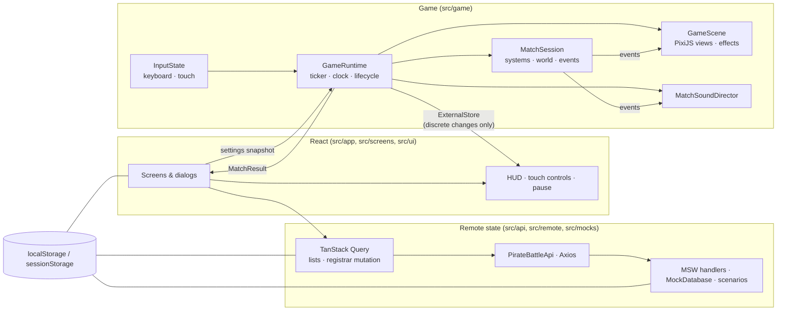
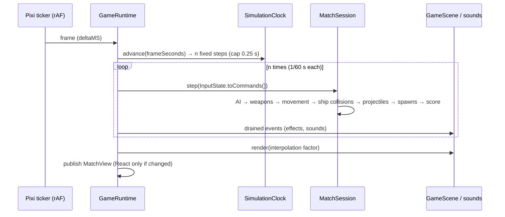
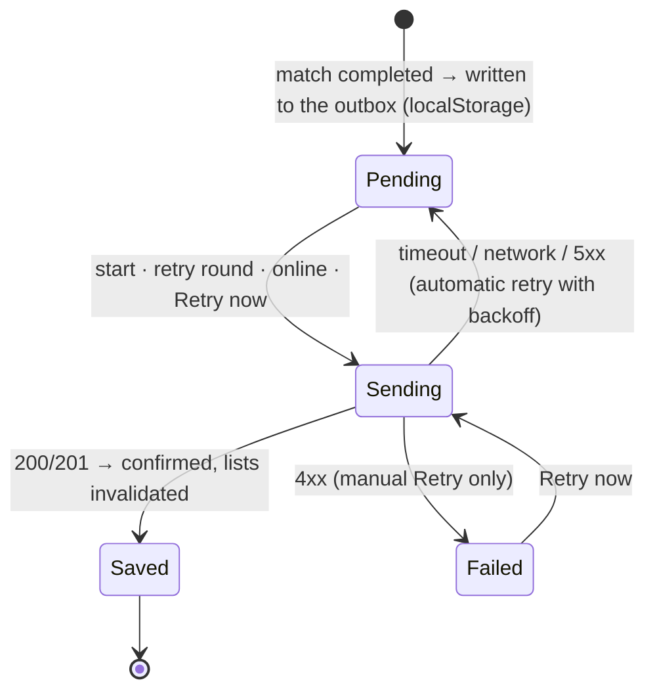

# Architecture

Pirate Battle is a single-page app: **React** draws menus, forms, dialogs and the HUD; **PixiJS** draws the
arena; a framework-free **simulation** owns the rules. Ranking and match history go through **Axios** and
**TanStack Query** to a REST API that **MSW** simulates in every environment.

## Module map

| Folder                             | Responsibility                                                                             |
| ---------------------------------- | ------------------------------------------------------------------------------------------ |
| `src/game/core`                    | Fixed-step clock, seeded RNG (mulberry32), immutable `Vector2`, angles and geometry        |
| `src/game/config`                  | Typed balancing config, Options validation, per-match frozen snapshot, configuration keys  |
| `src/game/sim`                     | Rules: world, entities, systems, AI, spawning, damage, match lifecycle, events, statistics |
| `src/game/input`                   | Key bindings (single source for input and instructions), `InputState`, keyboard source     |
| `src/game/render`                  | PixiJS: asset loading, scene, ship/projectile/health views, effects, letterboxing viewport |
| `src/game/audio`                   | Web Audio engine and the director that turns game events into sounds                       |
| `src/game/runtime`                 | `GameRuntime` (Pixi app + ticker + match), auto-pause, match factory, frame profiler       |
| `src/game/bridge`                  | `ExternalStore` and the `MatchView` the UI subscribes to                                   |
| `src/api`                          | REST contracts (zod), ranking rules, `ApiError`, Axios client                              |
| `src/remote`                       | Query client, query keys, hooks, persistent outbox and match registrar                     |
| `src/mocks`                        | MSW handlers, mock database, fixtures, network scenarios (browser and Node)                |
| `src/storage`, `src/profile`       | Versioned local stores (zod-validated) and repositories; captain name rules                |
| `src/screens`, `src/ui`, `src/app` | React screens, UI kit, HUD, app flow and service wiring                                    |
| `src/testing`                      | Test mode (`?test=1`), combat setups and the read-only test harness                        |

ESLint enforces the main boundary: `src/game/{sim,core,config}` cannot import React, PixiJS or browser
globals (`window`, `document`, `localStorage`, `performance`, `requestAnimationFrame`). The rules can therefore
run and be unit-tested in Node, deterministically. Coding conventions are in
[`docs/CODING_STANDARDS.md`](docs/CODING_STANDARDS.md).

## React ⇄ PixiJS integration

- `GameScreen` loads the textures (`useGameAssets`), then `GameStage` creates a `GameRuntime` **in an effect**
  and disposes it in the effect's cleanup. Under React Strict Mode (mount → unmount → mount) exactly one runtime
  stays alive; `GameRuntime.liveInstanceCount` is asserted by unit, integration and E2E tests.
- `mount()` is asynchronous (PixiJS `Application.init`). If `dispose()` runs first, the half-initialised
  application is destroyed as soon as `init` resolves. `dispose()` is idempotent and removes the ticker
  callback, keyboard and focus/visibility listeners, the `ResizeObserver`, the sound loops, every view and the
  canvas. Shared textures are kept for the next match.
- **No per-frame React renders.** The runtime publishes a `MatchView` (status, score, whole seconds left,
  health, pause reason, result) to an `ExternalStore` every frame, but the store notifies React only when a value
  actually changes (shallow compare). An integration test counts HUD renders while frames run.
- React → game: settings (snapshot), `pause()`, `resume()`, `restart()`, and `InputState` for the touch buttons.
  Game → React: `MatchView` and `onMatchEnded(result)`.
- The canvas is `aria-hidden`; the HUD exposes score, time, health and status as a semantic list, and a polite
  live region (`MatchAnnouncer`) announces only meaningful changes (status, time milestones, low health, score
  changes at most every few seconds, end).

## Simulation cycle

- **Time-based, frame-rate independent.** A fixed step of 1/60 s; the number of steps per frame depends only
  on elapsed time, so 30, 60 or 144 FPS produce the same simulation. Rendering interpolates between the last
  two steps. A single frame is capped at 0.25 s, so a long hitch is dropped instead of simulated as a burst.
- **Pause** (manual, window blur, hidden tab, portrait orientation on touch devices) freezes the match:
  no steps, no cooldowns, no spawn timer, no clock. Resuming needs a player action; it discards pending time
  and clears held inputs, so nothing accumulates while paused.
- **State machine:** `ready → running ⇄ paused → ended`. Once ended, `step()` does nothing (one guard), so
  movement, firing, damage, spawns and scoring all stop. When the player dies on the same step the time runs
  out, the reason is `playerDestroyed`. The result screen appears 1.5 s later to let the final explosion play.
- **Restart** creates a new `MatchSession` with a fresh configuration snapshot; the scene drops all entity views.
- **Determinism:** randomness comes only from the seeded RNG of the match (spawn points and kinds, the side an
  enemy prefers around islands, the escape turn of a stuck ship); the
  same seed and the same inputs give the same match. Tests use a manual clock (`time=manual`) that advances
  exactly the requested time through the same code path.
- **Domain events** (`weaponFired`, `projectileHit`, `shipDamaged`, `shipDestroyed`, `enemySpawned`, …) are
  produced by the systems and drained once per frame by the runtime: the scene turns them into effects, the
  sound director into sounds, `ScoreKeeper` and `MatchStatistics` count them. Presentation never writes to the
  simulation.

### Systems (in order)

| System                | What it does                                                                                  |
| --------------------- | --------------------------------------------------------------------------------------------- |
| `EnemyAiSystem`       | Delegates each enemy to its `EnemyBehavior` (Chaser, Shooter) — a new kind is a new behaviour |
| `WeaponSystem`        | Ticks cooldowns in simulation time; front (1 ball) and broadsides (3 balls) carry ship speed  |
| `MovementSystem`      | Rudder with momentum, forward-only thrust, sideways drift on water; hull kept out of islands  |
| `ShipCollisionSystem` | Chaser touching the player: explodes, damages, never scores; other overlaps separate          |
| `ProjectileSystem`    | Swept movement; first contact wins; damage once; removed on hit, island, range or arena exit  |
| `SpawnSystem`         | A wave every configured interval; opening sequence Chaser → Shooter; difficulty curve         |

## Ship handling (ADR-020)

The first version turned at a constant rate the moment a key was pressed and stopped turning the moment it was
released, and the ship always moved exactly along its bow. It felt rigid. Ships now keep momentum on water:

- **Rudder momentum.** `angularVelocity` eases towards `turnInput × turnSpeed` at `turnAcceleration` (rad/s²),
  both when starting and when stopping a turn. The player reaches full turn rate in 0.2 s; enemies in about
  0.15 s. The AI (`SteeringNavigator.turnInputFor`) brakes ahead of its target heading
  using the same limit (`√(2 · turnAcceleration · error)`), so enemies do not overshoot.
- **Velocity and drift.** Each ship has a world-space `velocity`. Thrust only acts along the bow (no reverse:
  JOG-01); the component along the bow accelerates or glides towards `throttle × maxSpeed`, and the sideways
  component (drift after a turn) fades with `exp(−lateralGrip · dt)`. The player drifts a little
  (`lateralGrip` 3.5/s, `deceleration` 140 px/s²: about 1.2 s of glide); enemies grip harder (5/s).
- **Shots carry the ship's speed.** A projectile's velocity is its muzzle velocity plus
  `velocityInheritance × ship.velocity` (1 for every weapon), so broadsides fired while sailing travel with the
  ship instead of falling behind it, and front shots never get overtaken by their own ship.
- **Joystick steering (ADR-023).** Touch players steer with a helm joystick that gives a target heading and a throttle
  (`PlayerCommands.steering`). The session turns it into the same rudder input the AI uses (`turnInputFor`,
  braking before the heading), so the ship obeys the same physics as with keys; held keys take precedence.
- All these numbers live in the typed config (`turnAcceleration`, `lateralGrip`, `velocityInheritance`) and the
  integration stays time-based: the same inputs give the same path at any frame rate.

## Collisions

- **Ships** are three circles (stern, midship, bow) along the heading — the hull is long and thin, so one circle
  either let the bow enter land or made ships collide far too early. `HullPlacement` moves a ship as close as
  possible to its target without any circle entering an island or leaving the arena. Ships slide along coasts:
  after a contact their velocity becomes the motion that was actually possible, minus 3 % per step, so a
  glancing hit keeps the ship gliding along the shore and a head-on hit stops it. A step that would leave the
  hull overlapping (a turn while pressed against a coast) is undone instead.
- **Islands** are axis-aligned rectangles built from the tile map: land tiles (`#` grass, `s` sand) are merged into horizontal runs,
  and runs with the same span on consecutive rows are joined (`buildIslandColliders`), giving a handful of boxes
  instead of hundreds of tiles. **Reef rocks** (`r`) are single tiles whose box is inset by 18 % of a tile on
  each side, matching the drawn boulder.
- **Projectiles** are tested as a segment from the previous to the next position (swept), so fast balls never
  tunnel through a ship or a coast. Player projectiles only hit enemies and vice versa. A hit applies damage
  exactly once and removes the projectile; destroyed ships stop colliding and firing, and their balls in flight
  are removed.
- **Ship vs ship**: symmetric separation, re-resolved against islands. Broad phase is a plain pair loop: with the
  alive cap of 14 enemies the cost is negligible (see [PERFORMANCE.md](docs/PERFORMANCE.md)).
- **Spawn points** are sampled in a band along the arena edges, must be free of islands and ships (hull radius
  plus clearance) and at least 480 px from the player; the farthest free water tile is the fallback.

## Rendering and resources

- `GameAssetLoader` loads the atlases once (a PixiJS bundle with progress and a 20 s timeout). A failure shows an
  accessible error with **Retry** before combat starts; failed requests are not cached, so retry is a plain reload
  of the bundle. Textures are shared by all matches and never destroyed by a scene.
- Atlases are generated by `npm run assets` from the provided sheets (`public/assets/game/`, 1× and 2×).
- `GameScene` layers: terrain, wakes, aim lanes, ships, smoke, projectiles, effects, health bars and reload arcs,
  damage numbers, hitboxes, damage flash. One view per entity; projectile sprites, wake and smoke puffs are
  pooled; effects are short-lived `TimedEffect` objects (muzzle flash, splash, explosion, sinking wreck, damage
  number) removed when they finish. Damage numbers have their own layer above the health bars, so a bar never
  hides them; consecutive numbers lean left and right.
- **Terrain** (`render/scene/terrain`, ADR-021, ADR-022) is drawn from the same arena definition as the colliders:
  - the sea is one `TilingSprite` of the provided water texture (`water.png`, a standalone copy of tile 73 so it
    can repeat on the GPU) that drifts and sways — a single quad. It covers the whole screen, not only the arena:
    on screens of another shape the extra sea is shaded and an edge line marks the arena bounds, so there are
    never empty bars;
  - islands: each island is a rectangle of one kind (`#` grass, `s` sand) drawn as a **nine-slice** of a complete
    island block taken from the provided tile sheet (`terrain` atlas, built by `npm run assets`): corners stay
    intact, edges and centre stretch to the island's size. The provided pieces only join seamlessly in the
    arrangement they were painted in (measured seam differences: about 2 for native joins, up to 57 for other
    pairs), so stitching single tiles produced visible seams; one block per island respects the art's borders.
    Every other island is mirrored so they do not all look alike;
  - shallow water: the provided shallows block as a nine-slice one tile larger than its island, slowly pulsing
    in opacity; reef rocks get a small shallows patch of their own;
  - props of the arena (`arenaDecor.ts`): the fort's walls, towers, gate and cannons, palms, ruins, boulders, a
    dinghy, a wreck aground with planks floating around it.

  `islandLayout.ts` reads the islands and rocks from the tile map and reports shapes the art cannot draw (not a
  rectangle, mixed grass and sand, thinner than two tiles); unit tests run it over the default arena, together
  with checks on channel widths, the open player start and props sitting on their islands. Islands never
  change, so **each island and its shallows are cached as their own small textures**: drawing them costs the
  area of the islands, not of the arena. The sea, the shallows, wakes and smoke follow presentation time, so
  they freeze on pause; the sea and the shallows also stay still when the player prefers reduced motion.

- **Wakes and smoke** (`PuffLayer`, one per style): every moving ship drops pairs of soft foam puffs behind its
  stern (`WakeEmitter`); damaged ships give off smoke (`SmokeEmitter`) — thin wisps below two thirds of their
  health, a thick plume below one third — that fades in, grows and drifts with the wind. Puffs are pooled
  sprites sharing one texture drawn on a canvas, capped per layer (360 wake, 240 smoke puffs).
- **Projectiles** draw a short streak behind each cannonball, as long as the distance it covers in 50 ms.
- **Gunnery aids** (`PlayerGunneryView`, player only): three arcs around the hull that fill up as each weapon
  reloads (gold when loaded), redrawn only when a weapon's readiness changes; and dashed lanes showing the
  direction and range of the bow chaser and of each broadside, built once in the ship's frame and only moved.
- **Developer overlays** (`SceneOverlays`, off by default): the aim lanes and `HitboxOverlayView` (island
  rectangles, hull circles, projectile radii, redrawn every frame from the simulation). They are switched on in
  the _Developer tools_ dialog behind the gear button of the main menu (README › Developer tools), stored by `DeveloperToolsRepository`, and passed
  to the runtime when a match starts, like the settings snapshot.
- Ship damage stages swap the hull texture and add flames as health drops; health bars above every ship use the UI atlas frame
  and a mask clipped to its fill area.
- **Viewport**: the world (1920 × 1088) is letterboxed into the available area with its proportions preserved;
  the renderer resolution follows the device pixel ratio (capped at 2). Resizing never changes the world, the
  rules or the arena bounds. Touch controls are DOM elements (a helm joystick and fire buttons), so
  pointer coordinates never need converting. The joystick moves its knob through a ref and a CSS transform, and
  the fire buttons' reload sweep is a CSS animation restarted per volley (keyed by the snapshot's volley
  counters), so neither re-renders React every frame.
- **Start banner and result highlights**: a "Battle stations!" banner shows the match length for the first two
  seconds (decorative, `aria-hidden`; the HUD already announces it). The result keeps `MatchHighlights`
  (cannonballs fired, hits, damage dealt and taken) from `MatchStatistics`, stored with the last result.
- Sounds: an `AudioEngine` (Web Audio) is created on the first gesture (autoplay policy), loads the converted
  files in the background and is muted with a persisted toggle; loops stop on pause, end, restart and dispose.

## Input

`KEY_BINDINGS` is the single source of truth for keyboard input and for the on-screen instructions.
`InputState` aggregates holders per action (the keyboard and each touch pointer), so moving and firing combine
freely and releasing one source never cancels another. The keyboard source is attached only while a match is
on screen, so menus and forms keep normal keyboard behaviour; `preventDefault` applies only to bound keys.

## Configuration and balancing

`DEFAULT_GAME_CONFIG` (`src/game/config/defaults.ts`) holds every gameplay number: durations, spawn interval and
distribution, health, speeds, turn rates, hull sizes, damage, projectile speed/range/radius, cooldowns, Shooter
ranges and aim tolerance, and the difficulty curve. Systems receive the config; none contains balancing
constants. `createMatchConfig()` merges the player's Options into a deep-frozen copy at the start of each match,
so changes made later only affect new matches.

Balancing decisions (ADR-007):

- The configured spawn interval is honoured exactly; difficulty grows on other axes, interpolated over the
  match time: enemies per wave 1 → 2 → 3, alive cap 6 → 9 → 14, Shooter share 30 % → 45 % → 60 %, enemy speed
  ×1.0 → ×1.3, Shooter cooldown ×1.0 → ×0.7 (keyframes at 0, 60 and 150 s).
- The first two waves are a Chaser and a Shooter, so both kinds always appear.
- The player is faster (170 px/s) and turns quicker (2.6 rad/s) than both enemies, so kiting is possible.
  Its rudder (13 rad/s²) is close to the enemies' (12–14) so it answers quickly, but it drifts more after a
  turn (ADR-020), which reads as a heavier ship without slowing it;
  the front cannon (20 dmg, 0.45 s) rewards aiming, broadsides (3 × 15 dmg, 1.4 s) reward positioning.
- A Chaser (30 HP) dies to two front shots; a Shooter (50 HP) to three. A ram costs 25 HP; a Shooter ball 10 HP.
- Options limits: session 60–180 s (1 s steps), spawn interval 1–10 s (0.5 s steps), both validated on input
  and when read from storage.
- Known balance trait: an idle player is sunk in about 40 s even with a 10 s interval — the game expects
  movement and firing.

## Local persistence

| Key                            | Storage        | Content                                                  |
| ------------------------------ | -------------- | -------------------------------------------------------- |
| `pirate-battle.settings.v1`    | localStorage   | Options                                                  |
| `pirate-battle.player.v1`      | localStorage   | Player id (UUID), captain name, whether it was confirmed |
| `pirate-battle.last-result.v1` | localStorage   | Last **completed** match result                          |
| `pirate-battle.audio.v1`       | localStorage   | Mute choice                                              |
| `pirate-battle.outbox.v1`      | localStorage   | Matches waiting to be saved; ids of confirmed ones       |
| `pirate-battle.mock-server.v1` | localStorage   | The mock server's stored matches                         |
| `pirate-battle.network.v1`     | localStorage   | Selected network scenario, seed, latency                 |
| `pirate-battle.dev-tools.v2`   | localStorage   | Developer tools: aim lanes and hitboxes on/off           |
| `pirate-battle.screen.v1`      | sessionStorage | Result screen open (comes back after a refresh)          |

Every value goes through `LocalStore<Value>`: JSON plus a zod schema; corrupted or outdated data is discarded,
and an unavailable storage behaves as empty. Refreshing or leaving during a match abandons it: nothing is stored
or sent.

## Ranking and match history

### Contracts

`src/api/contracts.ts` defines the zod schemas used **both** by the client (to validate responses) and by the
mock handlers (to validate requests):

| Endpoint                                             | Response                                                |
| ---------------------------------------------------- | ------------------------------------------------------- |
| `GET /api/ranking?configKey&page&pageSize`           | `Page<RankingEntry>`                                    |
| `GET /api/ranking/configurations`                    | Configurations that have matches                        |
| `GET /api/players/:playerId/matches?page&pageSize`   | `Page<MatchRecord>`                                     |
| `PUT /api/matches/:matchId` (`RegisterMatchRequest`) | `MatchRecord` — 201 created, 200 existing, 409 conflict |

A record holds match id, player id and name, end date, score, effective duration (pauses excluded), end reason
and the settings used; the server adds `configKey` (e.g. `s120-i3`) and `recordedAt`. The ranking compares only
matches with the same `configKey` and orders them by **points desc → duration asc → end date asc → match id**,
so ties always resolve the same way (ADR-011).

### Client and cache

- `PirateBattleApi` (Axios) validates every response and throws only `ApiError` (`timeout`, `network`, `http`,
  `invalidResponse`, `cancelled`, with `isRetryable`). Its deadline is an `AbortSignal`, not Axios' `timeout`,
  so timeouts and cancellations are always told apart, in the browser and in Node (ADR-014).
- TanStack Query: keys `['remote', 'ranking', configKey, page]`, `['remote', 'history', playerId, page]`,
  `['remote', 'ranking-configurations']`; data fresh for 15 s, cached 5 min; retryable errors retried twice
  with backoff (0.5 s, 1 s), 4xx never; refetch on window focus and reconnect.
- **Updating both tabs:** a confirmed registration invalidates every `['remote', …]` query, and showing a tab
  again always refetches it (`refetchOnMount: 'always'`) while the cached page stays visible.
- **Late answers:** each page has its own cache entry, and when a page loses its observers its request is
  aborted through the query's signal — an older answer can never replace the page on screen. Within one key,
  TanStack Query applies only the latest fetch.
- States in the UI: skeleton with `aria-busy` (first load), "Updating…" (background), error with Retry
  (`role=alert`), a notice when a refresh fails while old data stays, empty message, and the previous page kept
  visible while the next one loads.

### Registration and pending records (ADR-005, ADR-015)

1. When a match completes, its record is written to the outbox **before** any request.
2. `MatchRegistrar` sends it with a TanStack Query mutation (`MutationObserver`, so it keeps running outside any
   screen) as `PUT /matches/:matchId`. The request is idempotent: retrying after a timeout returns the stored
   record instead of creating a second one.
3. Only one request per match is in flight, however many times Retry is pressed (`scope` + an in-flight set).
4. Failures keep the record pending: retryable ones are retried by the mutation (twice) and then in rounds
   (3 s, 6 s, 12 s, 30 s), when the browser comes back online, and when the app starts after a refresh.
5. The result screen, the main menu and Match History show the status; nothing ever blocks playing, the Options
   or a new match.

### Mock server (MSW)

The same handlers run in the browser through the service worker (development, E2E and the **published build**)
and in Node (`msw/node`) for integration tests. `MockDatabase` keeps fixtures of 12 captains (seeded, four
configurations) plus confirmed matches in localStorage; ranking and history derive from the same records, so the
tabs are always consistent. Fourteen named, seeded scenarios simulate empty lists, many pages, slow and variable
latency, out-of-order answers, timeouts, connection failures, 4xx/5xx, single-endpoint failures, a timeout after
the server stored the match, and unavailability followed by recovery. They are selected in the **Network
scenarios** dialog or the URL and can be reset to the initial state (see README).

## Testing strategy

- **Unit (Vitest, Node):** rules and helpers — clock, RNG, geometry, config validation, movement, weapons,
  projectiles, collisions, AI, spawning, damage, scoring, pause, end of match, ranking rules, error mapping,
  outbox, scenarios, formatting.
- **Integration (Vitest, jsdom):** React screens with real repositories, Axios against MSW (`msw/node`),
  TanStack Query hooks, the registrar, keyboard input, auto-pause, runtime lifecycle under Strict Mode.
- **E2E (Playwright, Chromium desktop 1280×720 and Pixel 7 landscape):** every flow of the challenge, driving the
  real controls. Test mode only observes and controls time: a seed, a manual clock, named starting layouts and
  a read-only harness. Visual regression of the menu, the arena and the result screen with versioned Linux
  baselines; axe accessibility audits.
- **Performance and memory (`npm run perf`):** real-time runs on the production build — see
  [docs/PERFORMANCE.md](docs/PERFORMANCE.md).

## Limitations

- No real backend: ranking and history are simulated by MSW and stored in the browser; other players are
  fixtures. Clearing site data resets them.
- Visual baselines exist for Linux only (CI / Playwright Docker image); on other systems those checks are
  skipped with instructions.
- Matches are played in landscape on phones; portrait shows a "rotate your device" pause.
- The broad phase is a pair loop, adequate for the configured alive cap; a much larger cap would call for a
  spatial grid.
- Performance was measured on one desktop GPU (144 FPS, p95 7.1 ms) and, as worst cases, with software WebGL;
  other GPUs and browsers were not measured (see [docs/PERFORMANCE.md](docs/PERFORMANCE.md)).
