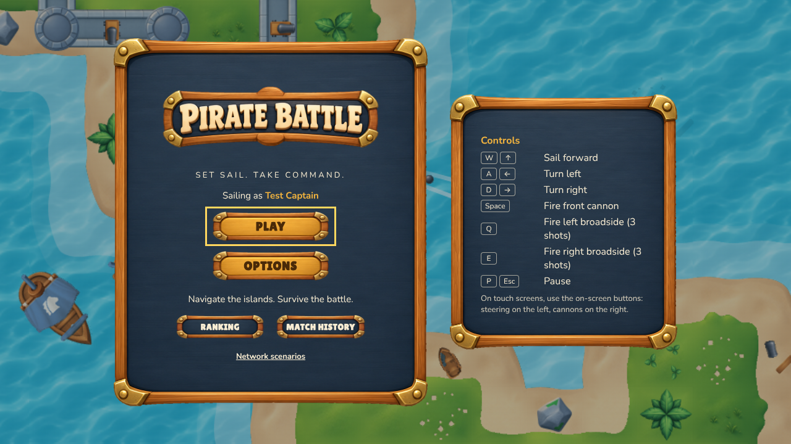
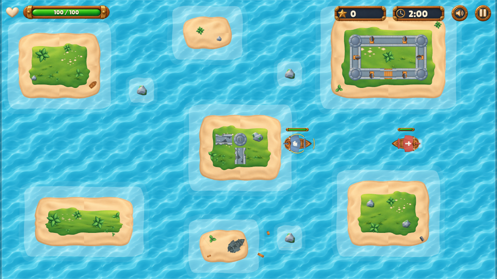
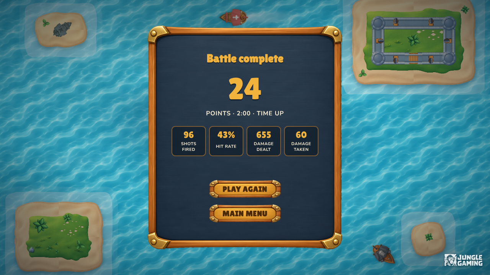

# Pirate Battle

A top-down 2D naval shooter built with **React**, **TypeScript (strict)** and **PixiJS**. Sail between islands, sink
enemy ships and score points until time runs out or your ship sinks. Ranking and match history go through
**Axios** and **TanStack Query** to a REST API simulated with **MSW**, and the whole game is covered by
**Playwright** end-to-end and visual regression tests.

**Live demo:** <https://game-developer-challenge-two.vercel.app/>

| Main menu                                                              | Battle                                                         | Result                                                           |
| ---------------------------------------------------------------------- | -------------------------------------------------------------- | ---------------------------------------------------------------- |
|  |  |  |

_The images are the visual regression baselines of the Playwright suite (desktop, 1280 × 720)._

## Contents

- [Quick start](#quick-start)
- [How to play](#how-to-play)
- [What is implemented](#what-is-implemented)
- [Architecture in brief](#architecture-in-brief)
- [Key decisions](#key-decisions)
- [Testing](#testing)
- [Options and local data](#options-and-local-data)
- [Ranking and Match History](#ranking-and-match-history)
- [Network scenarios and reproducing failures](#network-scenarios-and-reproducing-failures)
- [Developer tools and test mode](#developer-tools-and-test-mode)
- [Performance](#performance)
- [Assets](#assets)
- [Environment variables and commands](#environment-variables-and-commands)
- [CI and deployment](#ci-and-deployment)
- [How it was built](#how-it-was-built)

| Document                                   | Content                                                                                                    |
| ------------------------------------------ | ---------------------------------------------------------------------------------------------------------- |
| [ARCHITECTURE.md](ARCHITECTURE.md)         | React/PixiJS integration, simulation cycle, collisions, resources, persistence, ranking/history, decisions |
| [docs/PERFORMANCE.md](docs/PERFORMANCE.md) | Frame rate, p95 frame time, entity counts, memory over 5 cycles, environments and limitations              |
| [docs/reports/](docs/reports/summary.md)   | Test reports (Vitest JUnit + coverage, Playwright HTML) and profiling evidence                             |
| [docs/CREDITS.md](docs/CREDITS.md)         | Assets, conversions, fonts and licenses                                                                    |

## Quick start

Requirements: **Node.js 22** (see `.nvmrc`; 20.19 or newer works) and npm 10.

```bash
npm ci
npm run dev                       # http://localhost:5173
npx playwright install chromium   # once, before the first E2E run
npm run check                     # lint + type check + unit and integration tests
npm run test:e2e                  # Playwright, Chromium desktop and mobile
```

No backend or environment variables are needed: the ranking and history API is mocked in the browser.

## How to play

| Action                      | Keyboard          | Touch                       | On-screen (keyboard devices) |
| --------------------------- | ----------------- | --------------------------- | ---------------------------- |
| Sail forward                | `W` / `↑`         | Helm joystick (bottom left) | Middle button, left group    |
| Turn left / right           | `A` `D` / `←` `→` | Helm joystick (bottom left) | Side buttons, left group     |
| Fire front cannon           | `Space`           | Centre button (right group) | Middle button, right group   |
| Fire left / right broadside | `Q` / `E`         | Side buttons (right group)  | Side buttons, right group    |
| Pause / resume              | `P` / `Esc`       | Pause button (top right)    | Pause button (top right)     |

- **Goal:** each enemy sunk by your cannons is worth 1 point. A **Chaser** hunts you and explodes when it rams
  you (no point for that); a **Shooter** closes in and fires once you are within range. The match ends when the
  time runs out or your health reaches zero.
- **Moving and firing combine freely.** The front cannon fires one ball; each broadside fires three parallel
  balls from its side. Every cannon has its own reload, shown as a sweep on its HUD button.
- **Handling:** the ship has momentum. The rudder takes a fifth of a second to reach full turn, the hull drifts
  a little after a turn and glides for about a second after you stop sailing; cannonballs carry the ship's speed.
- **Touch:** drag the helm towards where you want to sail. The ship turns to that heading (braking before it gets
  there) at a speed that follows how far the knob is pushed. Phones play in **landscape**; held upright, the
  match pauses behind a "Turn your phone sideways" notice and waits for you to resume.
- **Pause:** manual (button, `P`, `Esc`) or automatic when the window loses focus or the tab is hidden. The
  clock, cooldowns and spawns stop; resuming always needs a player action, and nothing held during the pause
  carries over.
- **Reading the battle:** health bars above every ship; damage numbers when a ship is hit (red for you, gold for
  enemies); hulls, flames and smoke show each ship's condition. The sea, shallows and screen shake stop when the
  system asks for reduced motion.
- **The archipelago:** five hand-placed islands and two reef rocks. Channels are at least three tiles wide and
  islands keep two tiles from the edges, so a chased ship always has a way out.

The main menu lists the controls beside the menu on large screens; on phones a **Controls** button opens them in
a dialog. Game keys are captured only while a match is on screen.

## What is implemented

| Area                     | Highlights                                                                                                                                                                                                     |
| ------------------------ | -------------------------------------------------------------------------------------------------------------------------------------------------------------------------------------------------------------- |
| Gameplay                 | Forward-only sailing with momentum, both turns, front shot and three-ball broadsides, health, island collisions, arena bounds, Chaser and Shooter AI with obstacle avoidance, waves at the configured interval |
| Match rules              | 60–180 s matches, 1 point per kill (rams never score), end by time or death, a clean restart, pause and auto-pause, HUD with health, score and time, health bars over every ship                               |
| Feedback                 | Muzzle flashes, hits, splashes, explosions, sinking wrecks, damage numbers, hull deterioration, smoke, wakes, sounds                                                                                           |
| Screens                  | Loading screen, main menu, Options (validated, persisted), game, pause, result (survives a refresh), Ranking and Match History tabs                                                                            |
| Remote state             | Typed contracts, Axios client, TanStack Query lists with cache, invalidation and retries, a persistent outbox with idempotent registration                                                                     |
| Mocking                  | MSW in every environment (also the published build), 14 seeded network scenarios, reset to the initial state                                                                                                   |
| Accessibility and mobile | Keyboard navigation, visible focus, focus-trapped dialogs, labels, accessible errors, a semantic match summary with polite announcements, touch controls, landscape layout with a compact HUD                  |
| Quality                  | Strict TypeScript, ESLint with type-aware rules, 347 unit and integration tests, 67 Playwright tests run on desktop and mobile, visual baselines, performance and memory profiling                             |

## Architecture in brief

```
src/
  game/      framework-free rules (core, config, sim) + PixiJS rendering, input, audio and the runtime that joins them
  app/       boot (loading screen, preloading), service wiring and the screen flow
  screens/   React screens: main menu, options, game, result, Captain's Log
  ui/        UI kit, HUD, on-screen controls, menu backdrop
  api/       REST contracts (zod), ranking rules, Axios client
  remote/    TanStack Query client, hooks, outbox and match registrar
  mocks/     MSW handlers, mock database, fixtures and network scenarios
  storage/   versioned, validated local storage
  styles/    shared styles · shared/ cross-layer helpers · testing/ test mode and harness
```

- **The rules know nothing about the screen.** `src/game/{core,config,sim}` cannot import React, PixiJS or browser
  globals (an ESLint rule), so the whole match runs and is tested in Node.
- **One loop, two clocks.** PixiJS's ticker reports real time; a fixed-step clock turns it into 1/60 s simulation
  steps, and the scene interpolates between the last two. Pauses, cooldowns and spawns live in simulation time.
- **Events, not polling.** Systems emit domain events (`weaponFired`, `shipDamaged`, …) that drive the visual
  effects, the sounds and the score; presentation never writes to the simulation.
- **React only hears about changes.** The runtime publishes a small `MatchView` every frame to an external store
  that notifies React only when a value changes, so the HUD does not re-render per frame.
- **Lifecycles are explicit.** A match is created in an effect and disposed in its cleanup; under React Strict
  Mode exactly one runtime stays alive, and leaving releases the ticker, listeners, observers, views and canvas.

Details, diagrams and the systems' order are in [ARCHITECTURE.md](ARCHITECTURE.md).

## Key decisions

The full table, with the alternatives that were weighed, is in [ARCHITECTURE.md › Key decisions](ARCHITECTURE.md#key-decisions).

- **Fixed-step simulation** (1/60 s, frame cap 0.25 s): the same inputs give the same match at 30, 60 or 144 FPS,
  which also makes the tests reproducible.
- **The configured spawn interval is exact**; difficulty grows on other axes (wave size, alive cap, Shooter share,
  enemy speed), interpolated over the match. After play-testing the ramp was flattened: waves of two only come in
  the last half minute of a 3-minute match, and at most eight enemies are alive.
- **Island colliders come from the same tile map as the art**, merged into a few rectangles; islands are drawn as
  nine-slices of whole blocks from the provided tile sheet, because single tiles only join seamlessly in the
  arrangement they were painted in.
- **Ships have momentum** and shots carry the ship's speed; the touch helm gives a target heading that the ship
  reaches with the same rudder limits the AI uses.
- **Registration is idempotent** (`PUT /matches/:matchId`) and starts from a persistent outbox, so a timeout,
  a failure or a refresh never loses or duplicates a match. A TanStack Query `MutationObserver` sends it from a
  service, so it keeps going after the result screen is gone.
- **Request deadlines are `AbortSignal`s**, so a timeout and a cancellation are always told apart.
- **Landscape on phones**: held upright, the match pauses behind a notice instead of rotating the arena.
- **Linux visual baselines** are the reference (same as CI and the Playwright Docker image).

## Testing

Tests were written together with each feature, from the first commit. Three layers, each with its own job:

| Layer       | Tool                         | Environment                                    | What it proves                                                                                                                                                                                                                              |
| ----------- | ---------------------------- | ---------------------------------------------- | ------------------------------------------------------------------------------------------------------------------------------------------------------------------------------------------------------------------------------------------- |
| Unit        | Vitest (`*.test.ts`)         | Node                                           | The rules in isolation: clock, RNG, geometry, config validation, movement, weapons, projectiles, collisions, AI, spawning and difficulty, damage, scoring, pause, end of match, ranking rules, error mapping, outbox, scenarios, formatting |
| Integration | Vitest (`*.int.test.ts(x)`)  | jsdom + `msw/node`                             | Real collaborators: React screens with real repositories, Axios against the MSW handlers, TanStack Query hooks and cache, the registrar, keyboard input, auto-pause, the runtime's lifecycle under Strict Mode, no per-frame HUD renders    |
| End-to-end  | Playwright (`e2e/*.spec.ts`) | Production build, Chromium desktop and Pixel 7 | Every flow of the challenge through the real UI and the real game controls, plus visual regression and axe accessibility audits                                                                                                             |

**Latest run:** 347 unit and integration tests; 67 Playwright tests, run on desktop (1280 × 720) and on a
phone in landscape — 128 passed, 6 skipped (checks that only apply to one of the two devices). Reports:
[docs/reports/summary.md](docs/reports/summary.md).

### What each E2E spec covers

| Challenge requirement                                                     | Spec                                                                                 |
| ------------------------------------------------------------------------- | ------------------------------------------------------------------------------------ |
| Navigation, validation and persistence of the options                     | `options.spec.ts`                                                                    |
| Asset loading, failure and retry                                          | `assets.spec.ts`                                                                     |
| Match start, movement, rotation, arena limits and island collisions       | `match-start-and-movement.spec.ts`                                                   |
| Front and side shots, damage, cooldown and score without duplicates       | `combat.spec.ts`                                                                     |
| Chaser and Shooter behaviour, spawn interval                              | `enemies.spec.ts`                                                                    |
| End by time and by death, simulation stopped, clean restart               | `match-end.spec.ts`                                                                  |
| Pause, focus loss and resume without advancing the clock                  | `pause.spec.ts`                                                                      |
| Result screen and its persistence after a refresh                         | `result.spec.ts`                                                                     |
| Abandoned matches, repeated navigation, touch controls                    | `navigation-and-touch.spec.ts`, `result.spec.ts`                                     |
| Ranking and Match History: pagination, loading, empty, error              | `captains-log.spec.ts`                                                               |
| Registration, both tabs updated, pending record recovered after a refresh | `match-registration.spec.ts`                                                         |
| Retry after a timeout without duplicates, late answers never win          | `network-resilience.spec.ts`                                                         |
| Visual regression of the menu, a stable arena and the result              | `visual.spec.ts`                                                                     |
| Also: accessibility audits, sound, developer tools, boot                  | `accessibility.spec.ts`, `audio.spec.ts`, `developer-tools.spec.ts`, `smoke.spec.ts` |

### How the E2E tests stay reproducible

- **Test mode** (`?test=1`) adds a fixed seed, a manual clock (`time=manual`), named starting layouts and a
  read-only harness (`window.__PIRATE_BATTLE__`). It only observes and controls time: the rules, input,
  collisions and rendering run exactly as in normal play.
- **Combat tests drive the real controls**: they hold keys or touch the on-screen buttons and the helm, advance
  the manual clock and check the effects (positions, health, score, projectiles) through the harness.
- **Network tests choose a seeded MSW scenario** through the URL (`?scenario=…&networkSeed=…&latency=…`), so
  delays, failures and out-of-order answers happen the same way every time.
- **Every test starts isolated**: a fresh browser context with empty storage, and an automatic check that the
  console shows no unexpected errors.
- E2E runs always build the app and serve it on port 4174 (never reusing a running server). WebGL renders in
  software in the test browsers, so screenshots are stable; 2 workers by default (`PLAYWRIGHT_WORKERS`).
- **Visual baselines** live in `e2e/__screenshots__/`. Fonts and anti-aliasing differ between systems, so the
  **Linux** baselines are the versioned reference; elsewhere the visual checks are skipped with a message. Create
  local ones with `npm run test:e2e:visual:update`, or run the reference check with `npm run test:e2e:docker`.
- Failed tests keep a trace (`test-results/**/trace.zip`, open with `npx playwright show-trace`) and the HTML
  report (`npm run test:e2e:report`).

## Options and local data

The Options screen exposes the two settings the challenge asks for, plus the captain name. Values are validated
as they are typed (accessible error messages), saved with **Save**, and kept after a refresh. Each match takes
a snapshot of the saved options when it starts, so changes apply from the next match.

| Option            | Limits     | Step  | Default |
| ----------------- | ---------- | ----- | ------- |
| Game session time | 60–180 s   | 1 s   | 120 s   |
| Enemy spawn time  | 1–10 s     | 0.5 s | 3 s     |
| Captain name      | 1–20 chars | —     | random  |

Every other gameplay value (health, speeds, turn rates, damage, ranges, projectile speeds, cooldowns, Shooter
ranges, spawn distribution and the difficulty curve) lives in one typed config, `src/game/config/defaults.ts`.

| Key (localStorage)             | Content                                                       |
| ------------------------------ | ------------------------------------------------------------- |
| `pirate-battle.settings.v1`    | Saved options                                                 |
| `pirate-battle.player.v1`      | Player id and captain name                                    |
| `pirate-battle.last-result.v1` | Result of the last **completed** match (abandoned ones never) |
| `pirate-battle.audio.v1`       | Mute choice                                                   |
| `pirate-battle.outbox.v1`      | Matches waiting to be saved                                   |

`sessionStorage` remembers whether the result screen is open, so a refresh shows the result again; a refresh or
leaving during a match abandons it and returns to the menu. Invalid or outdated stored data is discarded.

## Ranking and Match History

The main menu opens the **Captain's Log** on either tab:

- **Ranking**: completed matches played with the **same settings**, 5 per page. The filter starts on your
  current options and lists every configuration that has matches. Order: more points → shorter match → earlier
  end → match id, so ties always break the same way. Your entries are marked **You**.
- **Match History**: your completed matches, newest first, with date, points, duration and how they ended.
  Matches still waiting to be saved are listed above it with **Retry now**.

Every completed match is written to the persistent outbox **before** it is sent with `PUT /api/matches/:matchId`.
The request is idempotent, so a retry after a timeout returns the stored record instead of creating a second
one. Pending matches survive failures and refreshes and are retried automatically (backoff rounds, coming back
online, app start) or with **Retry now**. The result screen shows the status (_Saving… / Saved / Not saved yet /
Could not be saved_). Nothing here ever blocks the game, the options or a new match.

The API is simulated by **MSW** in every environment, including the published build. The same handlers,
contracts (`src/api/contracts.ts`) and fixtures run in the browser and in Vitest (`msw/node`). Confirmed matches
are kept in `pirate-battle.mock-server.v1`; 12 fixture captains fill the ranking for four configurations.

| Endpoint                                   | Response                                        |
| ------------------------------------------ | ----------------------------------------------- |
| `GET /api/ranking?configKey&page&pageSize` | Ranking page for one configuration (`s120-i3`)  |
| `GET /api/ranking/configurations`          | Configurations that have matches                |
| `GET /api/players/:playerId/matches`       | The player's history page                       |
| `PUT /api/matches/:matchId`                | 201 created · 200 already stored · 409 conflict |

## Network scenarios and reproducing failures

Open **Developer tools** (the gear button in the bottom-left corner of the main menu) › **Network scenarios** to
choose how the mock server behaves, with a **seed** (reproducible delays) and a **base latency**. **Reset mock
server** restores the initial state: only the fixtures and the _Success_ scenario. The choice survives a refresh
(`pirate-battle.network.v1`) and can also be set through the URL, e.g. `/?scenario=slow&networkSeed=3&latency=0`.

| Scenario (`scenario=`)          | Behaviour                                                                      |
| ------------------------------- | ------------------------------------------------------------------------------ |
| `success`                       | Everything works with a short delay (base latency ±50 %)                       |
| `empty`                         | Ranking and Match History are empty                                            |
| `many-pages`                    | Extra entries: many pages in both lists                                        |
| `slow`                          | Every answer ~2.5 s slower                                                     |
| `variable-latency`              | Delays between 0.1 and 2.5 s (seeded)                                          |
| `out-of-order`                  | Odd requests slow (2 s), even ones fast: older answers arrive after newer ones |
| `timeout`                       | No answer: requests time out                                                   |
| `network-error`                 | Connection failure                                                             |
| `http-4xx`                      | 400 Bad Request (not retried automatically)                                    |
| `http-5xx`                      | 503 Service Unavailable                                                        |
| `ranking-fail` / `history-fail` | Only that list fails (500)                                                     |
| `register-timeout-after-commit` | The first save of each match is stored but never answered; a retry recovers it |
| `unavailable-then-recover`      | The first 3 requests to each endpoint fail with 503, then everything works     |

**Reproducing failures by hand**

1. _Server down at the end of a match:_ choose **Connection failure**, play a match → the result says _Not saved
   yet_; refresh → still pending (menu: "1 battle is waiting to be saved"); choose **Success** → it is saved once.
2. _Timeout after saving:_ choose **Timeout after saving**, finish a match → the first answer never arrives, the
   retry returns the stored record; Match History shows the match once.
3. _Late answers:_ choose **Out-of-order responses**, open Ranking and press Next/Previous quickly → the page on
   screen is always the last one asked for (obsolete requests are aborted).
4. _Errors:_ choose **Ranking fails** → the Ranking tab shows an error with **Retry**; Match History still works.

## Developer tools and test mode

The **Developer tools** dialog (gear button, main menu) keeps testing aids out of the players' way:

| Tool              | What it does                                                                                      |
| ----------------- | ------------------------------------------------------------------------------------------------- |
| Aim lanes         | Dashed lanes showing where the bow chaser and each broadside fire and how far (next match on)     |
| Hitboxes          | The shapes the rules collide: island rectangles, the three hull circles of each ship, cannonballs |
| Network scenarios | How the mock ranking/history server behaves (above)                                               |

Both overlays are off by default and are stored in `pirate-battle.dev-tools.v2`.

Test mode (`?test=1`) is what the Playwright suite uses:

| Parameter     | Example              | Effect                                                                        |
| ------------- | -------------------- | ----------------------------------------------------------------------------- |
| `seed`        | `seed=42`            | Fixed random seed (spawns, AI decisions)                                      |
| `session`     | `session=60`         | Game session time for this page (60–180), overrides Options                   |
| `spawn`       | `spawn=10`           | Enemy spawn time for this page (1–10, step 0.5), overrides Options            |
| `time=manual` | `time=manual`        | Real time stops; tests advance the game with `advanceTime(ms)`                |
| `touch=1`     | `touch=1`            | Shows the touch controls (helm joystick) on any device (also without `test`)  |
| `apiTimeout`  | `apiTimeout=1500`    | API request timeout in ms                                                     |
| `setup`       | `setup=chaser-ahead` | Starting layout for combat tests: `open-water`, `chaser-ahead`, `shooter-far` |
| `profile`     | `profile=1`          | Frame timing and entity counts for the performance report                     |

The harness (`window.__PIRATE_BATTLE__`) offers `state()` with entities and shot/hit/kill statistics, `config()`,
`advanceTime(ms)`, `setManualTime(bool)`, `liveRuntimes()`, `isPlayerHullBlocked()`, `isCircleBlocked()`,
`audio()` and `whenAudioLoaded()`.

## Performance

Target: 60 FPS during combat in the optimised build. On the reference desktop (Ryzen 7 5700X, RTX 5080, Chromium
headed, 1280 × 720) a full 3-minute match ran at **144 FPS** — the display's refresh rate — with a **p95 of
7.1 ms** between frames, no frame over 33 ms and about 1 ms of game work per frame. Five cycles of play → menu
left no live runtime or canvas in the page, the native objects (canvases, WebGL contexts, audio nodes) did not
grow from the first cycle to the fifth, and the heap flattened after the first cycle. Software
rendering (no GPU) is recorded as the worst case.

```bash
npm run perf          # 3-minute match + memory over 5 cycles, on the production build (headed by default)
```

Method, environments, raw evidence and limitations: [docs/PERFORMANCE.md](docs/PERFORMANCE.md).

## Assets

The provided assets are in [`assets/`](assets/). `npm run assets` converts them into PixiJS atlases under
`public/assets/game/` (committed, so a clean checkout needs no conversion):

- `ships.json` — from the Starling XML atlas of the ships;
- `tiles@1x.json` / `tiles@2x.json` — the 64 px and 128 px tile sheets (row-major, `tile_1` is top-left);
- `ui@1x.json` / `ui@2x.json` — the provided UI atlases (`borders` kept for nine-slices);
- `terrain@1x.json` / `terrain@2x.json` — the grass island, sand island and shallows blocks cut whole from the
  tile sheet, drawn as nine-slices; `water.png` — the water tile alone, so the sea repeats on the GPU;
- `public/assets/menu/*.png` — the same blocks as images for the menus' sea scene.

`npm run assets:audio` (needs ffmpeg) converts `assets/sounds` into `public/assets/audio`: effects to MP3, loops
to WAV for gapless looping (5.8 MB → 1.2 MB). Audio starts after the first click or key press. Fonts (self-hosted,
SIL Open Font License): Lilita One and Nunito. Sources and licenses: [docs/CREDITS.md](docs/CREDITS.md).

## Environment variables and commands

All variables are optional; copy `.env.example` to `.env.local` to override.

| Variable              | Default | Description                               |
| --------------------- | ------- | ----------------------------------------- |
| `VITE_API_BASE_URL`   | `/api`  | Base URL of the ranking/history REST API. |
| `VITE_ENABLE_MOCKS`   | `true`  | Starts the MSW worker that mocks the API. |
| `VITE_API_TIMEOUT_MS` | `8000`  | Request timeout in milliseconds.          |

| Command                                | Description                                                                           |
| -------------------------------------- | ------------------------------------------------------------------------------------- |
| `npm run dev`                          | Development server                                                                    |
| `npm run build`                        | Type check and production build (`dist/`)                                             |
| `npm run preview`                      | Serve the production build on http://localhost:4173                                   |
| `npm run lint`                         | ESLint (zero warnings allowed)                                                        |
| `npm run typecheck`                    | TypeScript project build check                                                        |
| `npm run format` / `format:check`      | Prettier                                                                              |
| `npm test`                             | Unit + integration tests (Vitest)                                                     |
| `npm run test:unit`                    | Unit tests only (Node)                                                                |
| `npm run test:integration`             | Integration tests (jsdom, React, MSW)                                                 |
| `npm run test:coverage`                | Tests with a coverage report (`coverage/`)                                            |
| `npm run test:e2e`                     | Playwright, Chromium desktop and mobile                                               |
| `npm run test:e2e:desktop` / `:mobile` | Only one of the two devices                                                           |
| `npm run test:e2e:visual`              | Visual regression only (`@visual`)                                                    |
| `npm run test:e2e:visual:update`       | Create or update the visual baselines of this platform                                |
| `npm run test:e2e:docker`              | The whole E2E suite in the official Playwright Docker image (Linux baselines)         |
| `npm run test:e2e:report`              | Open the last Playwright HTML report                                                  |
| `npm run perf`                         | Performance (3-minute match) and memory (5 cycles) runs on the production build       |
| `npm run perf:match` / `perf:memory`   | Only one of the two runs                                                              |
| `npm run reports`                      | Run Vitest (JUnit + coverage) and Playwright and store the reports in `docs/reports/` |
| `npm run assets` / `assets:audio`      | Rebuild the atlases / convert the sounds                                              |
| `npm run check`                        | Lint + type check + unit and integration tests                                        |

## CI and deployment

`.github/workflows/ci.yml` runs format, lint, type check, unit and integration tests and the build, then the E2E
suite in the official Playwright Docker image (same Linux baselines), uploading the HTML report and traces.

The game is a static site published on Vercel: **<https://game-developer-challenge-two.vercel.app/>**. Every push
to `main` is built by Vercel (`vercel.json`: `npm ci`, `npm run build`, output `dist/`), and
`mockServiceWorker.js` is served without caching so the mocks run in the published build. To run the E2E suite
against the published site:

```bash
PLAYWRIGHT_BASE_URL=https://game-developer-challenge-two.vercel.app npx playwright test
# PowerShell: $env:PLAYWRIGHT_BASE_URL='https://game-developer-challenge-two.vercel.app'; npx playwright test
```

## How it was built

The work was planned and tracked in an **Obsidian** vault kept outside this repository: each requirement of the
challenge was a note, each task linked the requirements it served, the modules it touched, its dependencies and
its tests, and every decision was written down with the alternatives considered (they are summarised in
[ARCHITECTURE.md › Key decisions](ARCHITECTURE.md#key-decisions)). A daily log recorded what was done, the commands
run and their results. Tests were written alongside each feature, and a task was only closed once its tests
passed.

Snapshots of the development, from that log and the commit history:

| Date   | Phase                | What came out of it                                                                                      | Unit + integration | E2E runs |
| ------ | -------------------- | -------------------------------------------------------------------------------------------------------- | -----------------: | -------: |
| 13 Oct | Foundation           | Vite + strict TypeScript, Vitest and Playwright set up, typed atlases built from the provided assets     |                  — |        — |
| 13 Oct | Simulation           | The whole match headless: clock, RNG, arena, ships, weapons, AI, spawner, match lifecycle, pause         |                137 |        — |
| 13 Oct | Rendering            | PixiJS scene and effects, input, HUD, touch controls, game screen flow                                   |                179 |        — |
| 13 Oct | Screens              | Menus, Options, pause, result, accessibility, the first Playwright suite                                 |                212 |       57 |
| 14 Oct | Ranking and history  | Contracts, Axios, TanStack Query, the outbox and registrar, MSW scenarios                                |                275 |       89 |
| 14 Oct | E2E, sound, visuals  | Combat and enemy E2E, visual baselines, sound                                                            |                296 |      115 |
| 14 Oct | Performance and docs | Profiling and memory runs, architecture and performance documents, test reports                          |                302 |      115 |
| 14 Oct | Polish and deploy    | Momentum and drift, shots that carry speed, animated sea, the published build                            |                321 |      115 |
| 14 Oct | Polish               | The redrawn archipelago, damage feedback, the helm joystick, developer tools                             |                332 |      126 |
| 15 Oct | Finish               | Loading screen, menu sea scene, keyboard-only focus ring, rotate-your-phone notice, a gentler difficulty |                339 |      128 |
| 15 Oct | Clean-up             | Shared helpers instead of repeated code, dead code removed, styles split by theme, this README           |                347 |      128 |

_E2E counts are runs over both devices (desktop and phone)._
